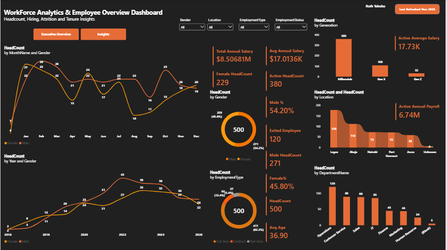

# HR Workforce Analytics | End-to-End Power BI Analysis

An end-to-end workforce analytics project exploring employee demographics, workforce composition, employment status, departmental distribution, location and salary indicators using Power BI.


## 1. Project Overview

This project analyses a synthetic HR dataset containing 500 employee records to provide insights into organisational workforce composition and employee distribution.

The objective was to transform employee records into meaningful information that can support workforce planning, employee retention investigations, resource allocation and HR decision-making.

I used Power BI, Power Query and DAX to carry out data preparation, feature engineering, data modelling, KPI development and dashboard creation.

**Project type:** End-to-end Data Analytics Case Study  
**Domain:** Human Resources Analytics  
**Dataset:** Synthetic employee workforce data  
**Tools:** Power BI Desktop, Power Query, DAX, Excel/CSV and GitHub

## 2. Business Problem

HR teams need reliable information about their workforce to make informed operational and strategic decisions. However, raw employee records do not automatically reveal workforce patterns or potential areas requiring management attention.

This analysis addresses questions such as:

- What is the total employee headcount?
- How many employees are active or have exited?
- What is the gender composition of the workforce?
- Which generation represents the largest employee population?
- How are employees distributed across locations and departments?
- What employment arrangements does the organisation rely on?
- What do the salary indicators reveal?
- What patterns are visible in the available hiring-date visualisations?

## 3. Project Objectives

- Inspect and prepare the employee dataset.
- Clean and validate employment date fields.
- Create demographic and time-based analytical attributes.
- Establish a relationship between employee and department tables.
- Develop workforce KPIs using DAX.
- Analyse workforce composition and distribution.
- Build an interactive Power BI dashboard.
- Translate analytical findings into business recommendations.

## 4. Tools and Technologies

| Tool | Application |
|---|---|
| Power BI Desktop | Data modelling and dashboard development |
| Power Query | Data cleaning and transformation |
| DAX | Calculated columns and KPI measures |
| Excel / CSV | Source data handling |
| GitHub | Versioned project storage and documentation |

## 5. Analytical Workflow

1. Business understanding and question definition.
2. Data import and inspection.
3. Data cleaning and standardisation.
4. Date validation and transformation.
5. Feature engineering.
6. Data modelling.
7. DAX measure development.
8. Exploratory data analysis.
9. Dashboard development.
10. Insight generation and business recommendations.



## 6. Data Preparation and Transformation

### Power Query

I used Power Query to inspect, clean and prepare the employee records.

Key transformations included:

- Standardising selected categorical values.
- Reviewing column data types.
- Creating `HireDate_clean` to handle missing and future hire dates.
- Creating `ExitDate_clean` to identify exit dates occurring before the cleaned hire date.
- Preserving missing and invalid dates as null values rather than treating them as valid dates.

The date validation logic used **30 September 2026** as the reference date for the hire-date check.

### DAX Feature Engineering

I created additional attributes to support demographic and time-based analysis.

| Attribute | Purpose |
|---|---|
| Employee Age | Calculates employee age using the defined reporting date |
| Generation | Groups employees into age-based categories |
| Year | Extracts the year from the cleaned hire date |
| MonthName | Creates readable month labels |
| Month | Provides numerical month ordering |

The generation categories used in this project are:

- Gen Z: age 25 and below
- Millennials: age 26–44
- Gen X: age 45–60
- Baby Boomers: above 60

These are project-defined age groupings.

## 7. Data Modelling

I connected the employee table, `Employees_Raw`, to the `Department` table using department names.

The intended relationship is one-to-many:

- One department can be associated with multiple employee records.
- The Department table provides the department-level information used to analyse employee distribution.

This relationship supports departmental filtering and reporting.

## 8. KPI Development Using DAX

I developed measures to summarise workforce composition and salary indicators.

| Measure | Analytical purpose |
|---|---|
| HeadCount | Counts distinct employee IDs |
| Active HeadCount | Counts employees marked Active |
| Exited Employee | Counts employees marked Exited |
| Male HeadCount | Counts male employees |
| Female HeadCount | Counts female employees |
| Male % | Calculates male workforce representation |
| Female% | Calculates female workforce representation |
| Avg Age | Calculates average employee age |
| Avg Annual Salary | Calculates average annual salary |
| Total Annual Salary | Calculates the sum of annual salary values |

Examples of DAX calculations:

**Total Headcount**
```dax
HeadCount =
DISTINCTCOUNT(Employees_Raw[EmployeeID])
```

**Active Headcount**
```dax
Active HeadCount =
CALCULATE(
    [HeadCount],
    Employees_Raw[EmploymentStatus] = "Active"
)
```

**Exited Employees**
```dax
Exited Employee =
CALCULATE(
    [HeadCount],
    Employees_Raw[EmploymentStatus] = "Exited"
)
```

**Male Workforce Percentage**
```dax
Male % =
DIVIDE(
    [Male HeadCount],
    [HeadCount],
    0
)
```

**Average Annual Salary**
```dax
Avg Annual Salary =
AVERAGE(Employees_Raw[AnnualSalaryUSD])
```

## 9. Dashboard Overview

The interactive dashboard provides a consolidated view of the workforce through KPI cards, charts and filters.

It covers:

- Total, active and exited employee counts.
- Gender distribution.
- Generation distribution.
- Employee distribution by location.
- Departmental headcount.
- Employment type distribution.
- Annual and monthly visualisations using hire-date attributes.
- Average annual salary and total annual salary indicators.

Available slicers include Gender, Location, Employment Type and Employment Status.

## 10. Key Findings

The analysis identified the following patterns across the 500 employee records.

| Workforce indicator | Finding |
|---|---:|
| Total Headcount | 500 |
| Active Employees | 380 |
| Exited Employees | 120 |
| Male Employees | 271 (54.2%) |
| Female Employees | 229 (45.8%) |
| Millennials | 360 (72%) |
| Generation X | 108 (21.6%) |
| Generation Z | 32 (6.4%) |
| Average Age | 36.90 |
| Average Annual Salary | Approximately $17,013.60 |
| Total Annual Salary | Approximately $8,506,810 |

### Location Distribution

| Location | Employees |
|---|---:|
| Lagos | 178 |
| Abuja | 112 |
| Nairobi | 73 |
| Port Harcourt | 72 |
| Accra | 59 |
| Unknown | 6 |

Lagos and Abuja account for 58% of the employee records, indicating workforce concentration in these locations.

### Department Distribution

| Department | Employees |
|---|---:|
| Operations | 120 |
| Customer Service | 89 |
| Sales | 88 |
| IT | 85 |
| Finance | 45 |
| Marketing | 44 |
| Human Resources | 24 |
| Unassigned | 5 |

Operations has the largest employee population. Operations, Customer Service, Sales and IT together account for 76.4% of the records.

### Employment Type

| Employment Type | Employees | Share |
|---|---:|---:|
| Full-time | 411 | 82.2% |
| Contract | 62 | 12.4% |
| Part-time | 27 | 5.4% |

The organisation's recorded workforce is predominantly full-time.

## 11. Business Recommendations

Based on the findings, the following actions would support better workforce management:

**1. Investigate employee exits**

Examine employee exits by department, location, tenure and exit reason to identify potential retention issues.

**2. Strengthen workforce planning**

Compare departmental staffing levels with workload and operational requirements, particularly in Operations, Customer Service, Sales and IT.

**3. Develop succession strategies**

The high concentration of employees in the Millennial category makes leadership development, knowledge transfer and succession planning useful areas for further investigation.

**4. Monitor workforce representation**

Review gender representation across departments, management levels, recruitment and compensation.

**5. Validate payroll reporting**

Separate active and exited employee records when calculating current payroll expenditure.

**6. Improve data quality**

Investigate the six unknown location records and five unassigned department records to improve reporting completeness.

**7. Establish continuous workforce monitoring**

Track active headcount, hiring, exits, attrition, employee tenure, departmental distribution and payroll indicators over defined reporting periods.

## 12. Data Quality Considerations and Limitations

The analysis has several limitations that should be considered before using the findings for management decisions:

- The 120 exited employee records do not establish an annual attrition rate. A defined reporting period and appropriate average headcount denominator are required.
- Six employee records have unknown locations.
- Five employee records have no assigned department.
- Salary indicators shown in the analysis use the full employee population. Current payroll should be calculated separately for active employees.
- The monthly and annual visualisations use hire-date attributes. They should not be interpreted as historical active headcount without an appropriate period-based workforce calculation.
- The generation categories follow the age boundaries defined for this project.
- The salary currency and calculation basis should be confirmed before using the indicators for financial decisions.
- The age and date calculations use a fixed reference date of 30 September 2026. This should be distinguished from the dashboard's displayed refresh date.

## 13. Skills Demonstrated

**Data Preparation**
- Data inspection and cleaning.
- Power Query transformations.
- Date validation.
- Data standardisation.

**Data Transformation**
- DAX calculated columns.
- Age calculation.
- Generation classification.
- Date attribute extraction.

**Data Modelling**
- Table relationships.
- Department and employee integration.
- Filter context considerations.

**Business Intelligence**
- DAX measures.
- KPI development.
- Interactive dashboard development.
- Workforce segmentation.
- Data visualisation.

**Business Analysis**
- Business problem definition.
- Exploratory analysis.
- Insight interpretation.
- Data quality assessment.
- Business recommendations.

## 14. Project Deliverables

- Power BI dashboard file.
- Workforce dashboard screenshot.
- Data preparation and transformation logic.
- DAX measures and calculated attributes.
- HR workforce analysis and findings.
- Business recommendations.
- Project documentation.

## 15. Access the Project

**Power BI File:** [Download the Power BI report](HR%20Project%20Workforce.pbix)

**Dashboard Preview:** See the screenshot above.

An interactive Power BI Service report link will be added here when public sharing has been configured and tested.

---

**Project Author:** Ruth Yakubu  
**Professional Focus:** Data Analytics | Business Intelligence | HR Analytics  
**Tools:** Power BI | Power Query | DAX  
**Project Type:** End-to-End Data Analytics Case Study
